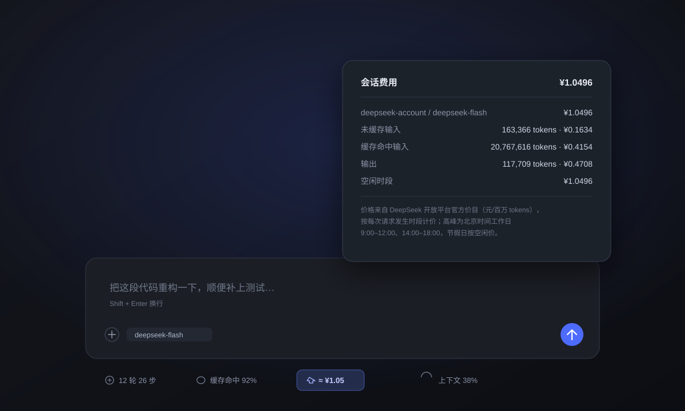

# dsh-spend-pill

[](https://github.com/debug-null/dsh-spend-pill/releases/latest)
[](https://github.com/debug-null/dsh-spend-pill/actions/workflows/ci.yml)
[](LICENSE)
[](https://github.com/topics/dsh-plugin)

DeepSeek Harness（DSH）Web 插件：在输入框下方显示**本次会话已花费的人民币金额**，点击查看明细。



<sub>界面示意：输入框下方的费用 pill（高亮）与点击后弹出的明细面板。</sub>

## 功能

- 在输入框下方的 composer dock 里增加一个费用 pill：`≈ ¥1.05`，就在系统自带的「轮次/步数」
  「缓存命中 / Token 用量」旁边。
- **点击**弹出明细：模型及其费用、未缓存输入 / 缓存命中输入 / 缓存写入 / 输出的 token 数与金额、
  高峰时段小计、空闲时段小计和合计；按 Esc 或点击弹层外部关闭。
- 按**每次请求结算时的模型和时段**计价：会话中途切换模型、或一轮跨越 12:00 / 14:00 / 18:00
  的峰谷边界，都能正确累加；时段以请求发出时间判定。
- **内置 2026 年法定节假日**：节假日（以及周末）按空闲价计费，不再是简单的「工作日」判断。
- 不联网、不保存任何数据，金额由会话自身的 provider 上报 token 用量推导。

## 安装

目前尚未发布到 npm，直接安装 GitHub Release 里的预构建包：

```sh
dsh plugin --profile desktop add \
  https://github.com/debug-null/dsh-spend-pill/releases/latest/download/dsh-spend-pill.tgz
```

Web 界面也可以在 **设置 → 插件 → 安装 bundle** 里粘贴同一个 URL。安装后刷新 Web 页面即可。

## 价格与计费规则

官方价目（人民币 / 百万 tokens，见
[DeepSeek API 文档](https://api-docs.deepseek.com/zh-cn/quick_start/pricing)）：

| 模型 | 时段 | 缓存命中 | 未命中 | 输出 |
| --- | --- | ---: | ---: | ---: |
| `deepseek-flash` | 高峰 | ¥0.04 | ¥2 | ¥8 |
| `deepseek-flash` | 空闲 | ¥0.02 | ¥1 | ¥4 |
| `deepseek-v4-pro` | 高峰 | ¥0.30 | ¥9 | ¥27 |
| `deepseek-v4-pro` | 空闲 | ¥0.15 | ¥4.5 | ¥13.5 |

高峰时段为**北京时间工作日 9:00–12:00、14:00–18:00**，其余时间（含周末与法定节假日）按空闲价
（高峰价的一半）计费。内置的 2026 年节假日来自
[国务院办公厅通知](https://www.gov.cn/zhengce/zhengceku/202511/content_7047091.htm)；2027 年的安排
公布后，用下面的 `holidays` 配置补上即可。旧模型 id `deepseek-v4-flash`、
`deepseek-v4-flash-vision-exp` 按 `deepseek-flash` 计价。

模型没有内置价格时（第三方 provider、未来新模型），按 `fallbackModel`（默认 `deepseek-flash`）
估算，并在弹层里标注「按 deepseek-flash 价格估算」。

## 可选配置

在 profile 的 `cordis.patch.yml` 里覆盖价格、别名、回退模型或节假日表：

```yaml
- id: cost-pill
  name: dsh-spend-pill
  config:
    prices:
      my-model:
        peak: { cacheHit: 0.04, cacheMiss: 2, output: 8 }
        offPeak: { cacheHit: 0.02, cacheMiss: 1, output: 4 }
    aliases:
      my-legacy-model: my-model
    fallbackModel: deepseek-flash
    # 整表替换内置日历，日期为北京时间（YYYY-MM-DD）
    holidays: ['2027-01-01', '2027-02-05', '2027-02-06']
```

`prices` 与 `aliases` 是在内置表上的增量覆盖；`holidays` 是整表替换。配置变化会改变投影的
`stateVersion`，已缓存的历史费用会按新配置重新计算。

## 说明

- 金额是按 provider 上报用量估算的参考值，不是账单；账户余额不在本插件范围内。
- 一段会话里切换过模型时，弹层会分模型列出各自费用，但 token 明细仍按桶汇总。
- 会话还没有产生计费用量时，pill 不显示。

## 开发与测试

```sh
node --check index.js && node --check client.js
node --test
```

`lib/cost.js` 是纯函数计价折叠（不依赖 DSH），`test/cost.test.mjs` 覆盖峰谷边界、节假日、
请求时间判段、同 Turn/Step 替换、重试、旧模型别名、第三方模型回退与配置覆盖；GitHub Actions
在每次 push / PR 时运行同样的检查。

---

## English

A DeepSeek Harness (DSH) Web GUI plugin that shows what the current session has cost so far, in
CNY, in the composer dock row — and opens a click-through breakdown dialog.

- Prices every settled assistant attempt with the **official DeepSeek CNY list price for the model
  and the period that attempt ran in** (peak / off-peak, request-time based), including the 2026
  Chinese public-holiday calendar.
- Click the pill for model, uncached input / cache-hit input / cache-write / output tokens with
  amounts, peak and off-peak subtotals, and the total. Escape or an outside click closes it.
- No network requests; figures come from the session's own provider-reported token usage.

### Install

```sh
dsh plugin --profile desktop add \
  https://github.com/debug-null/dsh-spend-pill/releases/latest/download/dsh-spend-pill.tgz
```

### Pricing

Official list prices in CNY per 1,000,000 tokens
([DeepSeek API docs](https://api-docs.deepseek.com/zh-cn/quick_start/pricing)): `deepseek-flash`
peak ¥0.04 cache-hit / ¥2 cache-miss / ¥8 output, off-peak half; `deepseek-v4-pro` peak ¥0.30 / ¥9 /
¥27, off-peak half. Peak is Beijing time, weekdays 09:00–12:00 and 14:00–18:00, excluding the
built-in 2026 public holidays; everything else bills off-peak.

Models without a built-in price are estimated at the `fallbackModel` price and the dialog says so.
Prices, aliases, the fallback model and the holiday list can be overridden through the plugin
`config` in `cordis.patch.yml`.

### Development

```sh
node --check index.js && node --check client.js
node --test
```

## License

MIT — see [LICENSE](LICENSE).
